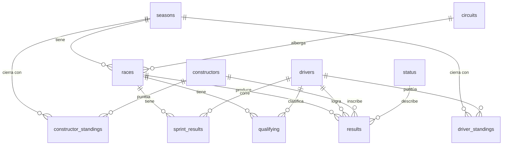

# 01 – Modelo de datos

## Dominio y fuente
**Fórmula 1, 1950 → presente**, con **datos históricos reales** (no sintéticos) obtenidos por API desde
[Jolpica-F1](https://api.jolpi.ca/ergast/f1/), sucesora comunitaria de la API Ergast (compatible, sin API key).

El enunciado habla de "datos sintéticos"; se usan datos reales porque el dominio los ofrece abiertos y son
verificables (cualquier respuesta del agente puede contrastarse con la historia real), lo que mejora la
evaluación del agente. Cumple igual el requisito de volumen (>15 registros por tabla) con holgura.

## Diagrama entidad-relación

## Tablas (11 + 1 vista)
| Tabla | Contenido | Filas aprox. |
|---|---|---|
| `seasons` | temporadas | 77 |
| `circuits` | pistas (país, ciudad, coordenadas) | 78 |
| `drivers` | pilotos (nombre, nacimiento, nacionalidad, código) | 881 |
| `constructors` | equipos | 214 |
| `status` | motivos de finalización (Finished, Engine, Accident…) | 136 |
| `races` | Grandes Premios (año, ronda, circuito, fecha) | 1.172 |
| `results` | resultado de cada piloto en cada carrera (hechos centrales) | 26.247 |
| `qualifying` | clasificación con Q1/Q2/Q3 (desde 1994) | 11.342 |
| `sprint_results` | carreras sprint (desde 2021) | 612 |
| `driver_standings` | campeonato de pilotos, posición final por año | 3.129 |
| `constructor_standings` | campeonato de constructores, final por año (desde 1958) | 924 |
| `v_results` (vista) | `results` con todos los nombres ya resueltos (facilita el SQL del agente) | = results |

El esquema completo y comentado está en `src/database/schema.sql` (única fuente de verdad; también se
inyecta en el prompt del agente).

## Decisiones de diseño
- **Normalización (3FN):** pilotos, equipos, circuitos y estados son entidades propias; `results` solo
  guarda claves. Un piloto puede cambiar de equipo entre carreras, por eso `constructor_id` está en
  `results` y no en `drivers`.
- **Claves naturales como TEXT** (`driver_id='max_verstappen'`, `circuit_id='monza'`): legibles, estables y
  idénticas a las de la API; facilitan que el LLM escriba SQL correcto. Las carreras usan clave sustituta
  `race_id` + `UNIQUE(year, round)`.
- **`position` vs `position_order`:** `position` es NULL si el piloto no fue clasificado (R, D, W…), pero
  `position_order` siempre existe, para ordenar llegadas completas.
- **Standings solo finales por temporada:** responde "¿quién fue campeón?" sin descargar ~1.100 consultas
  extra por ronda. El detalle por carrera se obtiene agregando `results`.
- **Autos compartidos:** en los años 50 un piloto podía figurar dos veces en una carrera (83 casos), por eso `results` es único por (carrera, piloto, equipo, nº de auto) y no por (carrera, piloto). Hay 3 carreras con victoria compartida.
- **Integridad:** claves foráneas activas, control de completitud contra el total de la API, verificación con
  `PRAGMA foreign_key_check` al terminar la carga.
- **Fuera de alcance:** vueltas y pit stops (millones de filas / endpoint por carrera, no aportan al TP).

## Cómo se obtienen y cargan los datos
`python scripts/init_db.py` → `src/database/builder.py` usa `src/database/jolpica.py`:
1. Pagina cada endpoint (100 filas/página, ~550 requests en total).
2. Cachea cada respuesta en `data/raw/jolpica/` (reanudable, respeta el límite ~500 req/h con
   reintentos ante 429).
3. Inserta en orden de dependencias y valida integridad.
4. `--offline` reconstruye la BD solo desde la caché; la BD resultante (`data/db/f1.db`) también se entrega.
