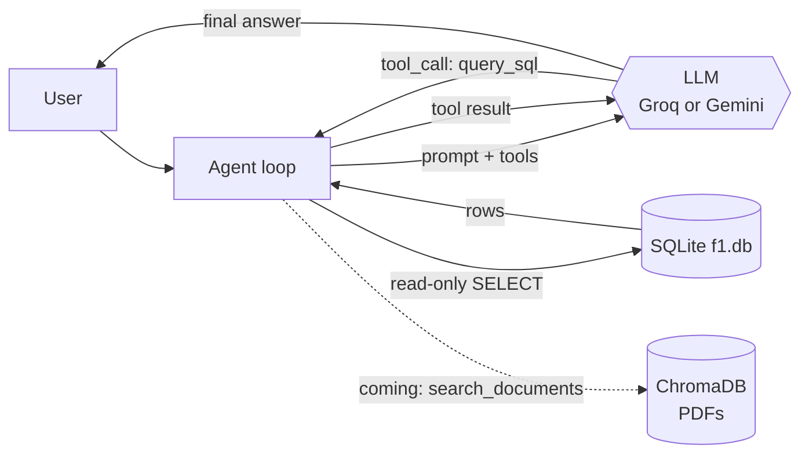

# Architecture and decisions

## Agent flow

1. The user asks a question.
2. The agent sends it to the LLM together with the system prompt (schema, examples, hints) and the tool definitions.
3. The LLM does not answer from memory: it emits a `query_sql` *tool call* with a query (*function calling*).
4. The agent runs the SQL in read-only mode and returns the rows as the *tool result*.
5. The LLM writes the answer. If the SQL fails, it receives the error and fixes it (up to 6 rounds).

Every question is logged to `data/logs/agent.jsonl` (executed SQL, rows, tokens, time, status).

## System prompt (`src/agent/prompts.py`)
Behavior rules + domain hints + 6 question→SQL examples (*few-shot*, verified by the tests) + the real schema
read from `schema.sql`, so it never drifts from the database.

## SQL tool safety (`src/database/connection.py`)
The LLM is assumed to be fallible, so there are four independent controls:
1. SQLite connection with `mode=ro` (read-only).
2. SQLite *authorizer*: a hook that rejects everything that is not a read.
3. Only one statement is accepted and it must start with `SELECT` or `WITH`.
4. Row cap (200; 100 sent to the LLM) and a 5 s timeout.

Tests try `DROP`, `DELETE`, `INSERT`, `UPDATE`, `PRAGMA`, `ATTACH` and multiple statements; all are rejected.

## Partial-coverage warning
Some tables do not cover the whole history (`qualifying` from 1994, `sprint_results` from 2021, `constructor_standings` from 1958).
If a query uses one of them, the tool itself adds a `coverage_note` field to the result and the prompt forces the LLM to include it.
Reason: in the first evaluation the agent said Senna had 3 poles (he had 65) without warning that data was missing.

## Interchangeable LLM providers (`src/agent/llm/`)
The agent works with messages in a neutral format and each provider (`gemini.py`, `groq_provider.py`) translates it to its own API.
It is selected with `LLM_PROVIDER` in `.env`. Transient errors (429/5xx) are retried with increasing waits; if the provider
reports that the daily quota is exhausted, the agent stops immediately with a clear message.

| Free plan | Observed limit |
|---|---|
| Gemini | 20 requests per day per model (≈10 questions: not enough to evaluate) |
| Groq | 1,000 requests per day and 8,000 tokens per minute per model (answers take 20–70 s) |

## Decisions
| Decision | Chosen | Why | Discarded alternative |
|---|---|---|---|
| Data | Real F1, 1950–today | Verifiable against real history | Synthetic data: not verifiable |
| Database | SQLite | One file, no server | PostgreSQL/MySQL: need a server |
| Agent | Own loop with function calling | Simple to explain and to log | LangChain/LangGraph: more pieces to explain |
| Prompt | Schema + 6 examples + hints | More accurate than schema alone | Schema only: more errors on edge cases |
| Evaluation | *Golden set* with the answer computed from the database | Objective and repeatable | Manual review |
| RAG *(pending)* | ChromaDB + local embeddings | No server, no cost | Cloud services |
| UI *(pending)* | Streamlit | Simple web chat | — |

## Problems found and how they were solved
- **89 results lost while loading** (drivers sharing a car in the 1950s): the `UNIQUE` constraint was too strict.
  Fixed, and the loader now checks the row count against the API total.
- **Gemini:** one model was discontinued and another took up to 105 s; each was measured and the fastest, most stable one was chosen.
- **Gemini quota exhausted after ~10 questions:** Groq was added as a second provider.
- **Wrong answer without a warning (Senna's poles):** the automatic `coverage_note` was added.
- **Useless retries when the daily quota was exhausted:** this is now detected and the agent stops.

## Pending: RAG
PDFs are split into *chunks*, converted to *embeddings* and stored in ChromaDB. A second tool, `search_documents`, will return
the fragments closest to the question with file and page. The LLM will decide whether to use SQL, documents or both.
