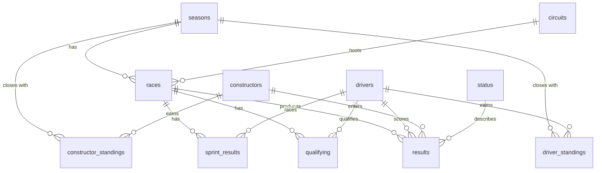

# Data model

## Data source
**Real** Formula 1 data since 1950, downloaded by script from a free public API
([Jolpica-F1](https://api.jolpi.ca/ergast/f1/), the successor of Ergast). The assignment mentions synthetic data; real data was used
because every answer of the agent can be checked against actual history.

## Entity-relationship diagram

## Tables (11 + 1 view)
| Table | Content | Rows |
|---|---|---|
| `seasons` | seasons | 77 |
| `circuits` | circuits (country, city) | 78 |
| `drivers` | drivers (name, birth date, nationality) | 881 |
| `constructors` | teams | 214 |
| `status` | how each driver finished (Finished, Engine, Accident…) | 136 |
| `races` | Grands Prix | 1,172 |
| `results` | result of each driver in each race (**fact table**) | 26,247 |
| `qualifying` | qualifying, from 1994 | 11,342 |
| `sprint_results` | sprint races, from 2021 | 612 |
| `driver_standings` | final drivers' championship position per year | 3,129 |
| `constructor_standings` | final constructors' championship position per year, from 1958 | 924 |
| `v_results` *(view)* | `results` with driver, team and circuit names already resolved (simplifies the SQL the LLM writes) | 26,247 |

Every column is commented in `src/database/schema.sql`, which is also injected into the agent's prompt.

## Design decisions
- **Normalized:** drivers, teams, circuits and statuses are separate tables; `results` only stores foreign keys.
- **Readable natural keys** (`driver_id = 'senna'`, `circuit_id = 'monza'`) instead of numbers: they help the LLM write correct SQL.
- **Standings: only the final position of each year.** Enough for "who was champion?" and avoids thousands of extra requests.
- **Shared cars (1950s):** a driver can appear twice in one race and 3 races had a shared win;
  that is why `results` is unique per (race, driver, team, car number) rather than per (race, driver).
- **Out of scope:** laps and pit stops (millions of rows that add nothing to the assignment).

## Data loading
`python scripts/init_db.py` downloads each paginated endpoint (~550 requests), stores every response in a local cache
(`data/raw/`, which allows resuming and rebuilding with `--offline`), inserts in dependency order and verifies
referential integrity (`PRAGMA foreign_key_check`) and that the row count matches the total reported by the API.
